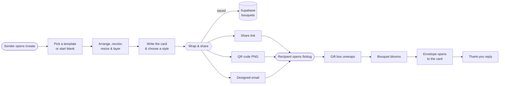
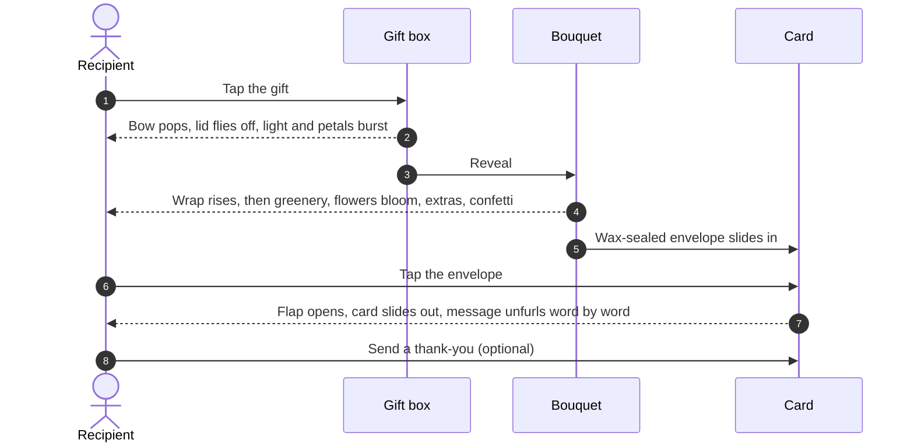
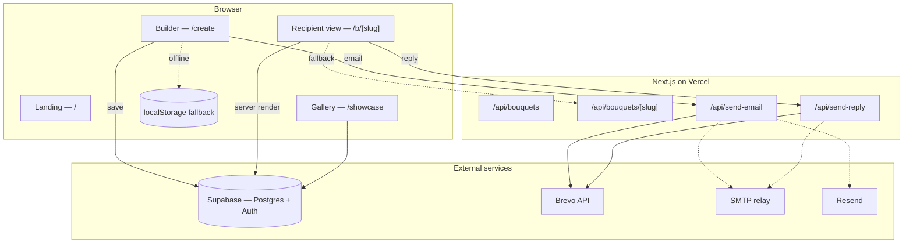
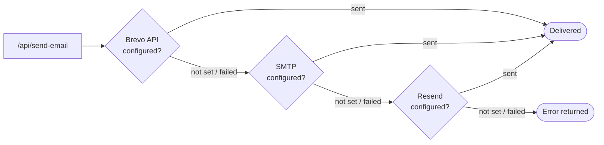

<div align="center">


# Bloomly

### Flowers that never wilt.

Arrange a hand-drawn bouquet, tuck a heartfelt letter inside, and send it as a gift that unwraps itself on screen.

[**Live site →**](https://bloomly-love.vercel.app) &nbsp;·&nbsp; [Create a bouquet](https://bloomly-love.vercel.app/create) &nbsp;·&nbsp; [Gallery](https://bloomly-love.vercel.app/showcase)

<br />


</div>

<br />

## ✿ Overview

**Bloomly** is a web app for sending digital flower bouquets. A sender composes an arrangement from an illustrated library of flowers, greenery, wraps and keepsakes, writes a personal card, and shares it as a link, an email or a printable QR code. The recipient opens a wrapped gift box that unties itself, watches the bouquet bloom piece by piece, and unseals an envelope to read the card.

No accounts, no downloads — just a link and a moment.

<table>
  <tr>
    <td width="33%" valign="top">
      <h4>🎨 Compose</h4>
      A drag-and-drop canvas with 42 hand-drawn, recolorable illustrations, six starter templates, undo/redo and smart layering.
    </td>
    <td width="33%" valign="top">
      <h4>💌 Send</h4>
      One click wraps the bouquet into a private link, a designed email built for the inbox, and a high-resolution QR code.
    </td>
    <td width="33%" valign="top">
      <h4>🎁 Unwrap</h4>
      An animated unboxing: the lid flies off, flowers bloom in sequence, and a wax-sealed envelope reveals the card.
    </td>
  </tr>
</table>

<br />

## ✿ How it works

### The journey



### 1 · Composing a bouquet — `/create`

The builder is a three-panel workspace, which becomes a guided **Add → Arrange → Send** flow on phones and tablets:

| Panel | What it does |
| :--- | :--- |
| **Library** | Search or browse *Flowers*, *Wraps*, *Greens* and *Extras*. Click an item to add it, or drag it straight onto the canvas. Custom images can be uploaded (up to 1.5 MB). |
| **Canvas** | A 5 : 6 stage that always fits the screen. Drag to move, use arrow keys to nudge, and a crisp selection frame shows what you're editing. |
| **Inspector & card** | Recolor, rotate, resize, mirror and reorder the selected piece; review every layer; write the card with a live preview; choose whether it appears in the public gallery. |

Thoughtful defaults keep arrangements looking right without effort. New flowers automatically **tuck in behind the wrap** so their stems disappear inside, while bows and keepsakes land on top. Every edit is undoable (`Ctrl+Z` / `Ctrl+Shift+Z`), destructive actions offer an *Undo* toast instead of a confirmation dialog, and the page warns before you leave with an unshared design.

### 2 · Sharing — *Wrap & share*

Wrapping saves the bouquet under a random 8-character slug and opens the share sheet:

- **Link** — `https://…/b/<slug>`, one tap to copy.
- **Email** — a designed gift-card email sent on the sender's behalf (see [Email delivery](#-email-delivery)).
- **QR code** — a 600 px PNG for greeting cards, gift tags or a real-world bouquet.

### 3 · Unwrapping — `/b/<slug>`

The recipient's experience is choreographed in three acts:



Every piece of motion respects **`prefers-reduced-motion`**: those visitors go straight to the finished bouquet and card, with no confetti or animated text.

<br />

## ✿ Architecture



**Rendering.** The landing page is a Server Component with small client islands (intro, FAQ, contact form). The recipient page is server-rendered with dynamic Open Graph metadata, so shared links unfurl as *"A bouquet is waiting for …"* in chat apps.

**Resilience.** Data access in [`src/lib/supabase.ts`](src/lib/supabase.ts) falls back to `localStorage` whenever Supabase is unavailable, so the app keeps working in development or offline. If a saved bouquet references an illustration the running build doesn't know, it renders a tinted fallback blossom instead of leaving a gap.

**Coordinates.** Every bouquet lives in a fixed **500 × 600** coordinate space, and each piece is sized as a percentage of the canvas (19.2 % × 16 %, times its scale). The builder, recipient view, gallery and template previews all share the same math, so what the sender arranges is exactly what the recipient sees, on any screen.

<br />

## ✿ Data model

A bouquet is a single row in the Supabase `bouquets` table:

| Column | Type | Notes |
| :--- | :--- | :--- |
| `slug` | `text` | Public 8-character identifier used in the share URL |
| `owner_id` | `text` | Anonymous Supabase user id (or a local id) of the creator |
| `title` · `message` | `text` | Card content |
| `sender_name` · `recipient_name` | `text` | Shown on the gift, card and email |
| `composition` | `jsonb` | Ordered list of canvas elements (below) |
| `card_style` | `text` | `<card theme>\|<canvas background>`, e.g. `rose\|pink` |
| `is_public` | `boolean` | Listed in the gallery when `true` |
| `view_count` | `int` | Incremented by the `increment_view_count` RPC |
| `created_at` | `timestamptz` | |

Each element in `composition`:

```ts
{
  id: string;              // unique per element
  assetId: string;         // e.g. "flower-peony", or "custom-upload"
  x: number;               // center, in the 500 × 600 space
  y: number;
  rotation: number;        // degrees
  scale: number;           // 1 = default size
  z: number;               // stacking order
  tint: string;            // hex color applied to the illustration
  flipX?: boolean;
  flipY?: boolean;
  customImageUrl?: string; // data URL for uploads
}
```

> [!IMPORTANT]
> Asset ids are persisted in saved bouquets. Never rename or remove an entry in [`src/lib/assets-seed.ts`](src/lib/assets-seed.ts) — redraw it in place instead.

<br />

## ✿ The illustration library

All 42 illustrations are hand-written SVG in [`src/lib/assets-seed.ts`](src/lib/assets-seed.ts): no image files and no network requests.

| Category | Count | Includes |
| :--- | :---: | :--- |
| 🌷 **Flowers** | 17 | Garden Rose, Peony, Ranunculus, Tulip, Sunflower, Poppy, Cosmos, Gerbera, Calla Lily, Cherry Blossom, Hydrangea… |
| 🌿 **Greens** | 7 | Eucalyptus, Baby's Breath, Fern, Dusty Miller, Olive Branch, Monstera, Golden Wheat |
| 🎀 **Wraps** | 6 | Kraft Paper, Pleated Paper, Glass Vase, Woven Basket, Ceramic Pot, Ribbon-Tied Stems |
| ✨ **Extras** | 12 | Satin Bow, Gift Tag, Love Letter, Heart Balloon, Butterfly, Ladybug, Honey Bee, Teddy Bear… |

Every illustration follows the same conventions, so arrangements feel cohesive and any color works:

- The tintable surface uses `currentColor`; shading is a black or white overlay at low opacity.
- Flower heads sit in the upper half of a 100 × 100 viewBox, with stems ending near `(50, 94)` so they converge naturally into a wrap.
- Light-colored pieces carry a faint outline so they stay visible on white.

<br />

## ✿ Email delivery

Bouquet emails are rendered by [`src/lib/email/bouquetEmail.ts`](src/lib/email/bouquetEmail.ts) and designed for inbox placement first:

- **No images.** The flower mark and gift box are drawn with table cells, so nothing is blocked or clipped.
- **One link**, a plain-text alternative and a personal tone, to stay in Gmail's *Primary* tab.
- **Progressive motion.** Apple Mail plays gentle animations; other clients show the same design at rest.
- **Light and dark mode**, mobile-responsive, with all user input HTML-escaped.

The email API tries each provider in order and uses the first one that succeeds:



<br />

## ✿ Project structure

```text
src/
├── app/
│   ├── page.tsx                 # Landing page (Server Component)
│   ├── create/page.tsx          # Builder route
│   ├── b/[slug]/page.tsx        # Recipient route + Open Graph metadata
│   ├── showcase/page.tsx        # Public gallery
│   ├── api/
│   │   ├── bouquets/            # Save, list and fetch bouquets
│   │   ├── send-email/          # Send the bouquet email
│   │   └── send-reply/          # Deliver thank-you replies
│   ├── layout.tsx               # Fonts, metadata, footer
│   └── globals.css              # Theme tokens and keyframe animations
├── components/
│   ├── Builder.tsx              # The bouquet editor
│   ├── RecipientView.tsx        # Unwrap → bloom → card experience
│   ├── landing/                 # Intro splash, hero bouquet, FAQ, contact form
│   ├── recipient/               # GiftBox and KeepsakeCard
│   ├── Navbar.tsx
│   └── Footer.tsx
└── lib/
    ├── assets-seed.ts           # The illustration library
    ├── supabase.ts              # Data access with localStorage fallback
    └── email/bouquetEmail.ts    # Email template
```

<br />

## ✿ Getting started

**Prerequisites:** Node.js 20+ and npm.

```bash
git clone https://github.com/antonbennedict/bouquet.git
cd bouquet
npm install
npm run dev
```

Open **http://localhost:3000**. Without any environment variables the app runs fully in local mode, saving bouquets to your browser's `localStorage`.

### Environment variables

Create a `.env` file in the project root. Every variable is optional; add the ones for the services you use.

| Variable | Purpose |
| :--- | :--- |
| `NEXT_PUBLIC_SUPABASE_URL` | Supabase project URL |
| `NEXT_PUBLIC_SUPABASE_ANON_KEY` | Supabase anon key (or `NEXT_PUBLIC_SUPABASE_PUBLISHABLE_KEY`) |
| `NEXT_PUBLIC_SITE_URL` | Public base URL used in email links (falls back to the request host) |
| `BREVO_API_KEY` | Brevo transactional email, the first choice |
| `BREVO_SENDER_EMAIL` · `BREVO_SENDER_NAME` | Verified Brevo sender; this inbox also receives thank-you replies |
| `SMTP_HOST` · `SMTP_PORT` · `SMTP_USER` · `SMTP_PASS` | SMTP relay, the second choice |
| `RESEND_API_KEY` | Resend, the final fallback |

> [!CAUTION]
> Never commit `.env` — it is already listed in `.gitignore`.

### Scripts

| Command | Description |
| :--- | :--- |
| `npm run dev` | Start the development server |
| `npm run build` | Create a production build |
| `npm start` | Serve the production build |
| `npm run lint` | Run ESLint |

### Deployment

The `main` branch deploys automatically to **Vercel**. Add the environment variables above under *Project → Settings → Environment Variables*.

<br />

## ✿ Design principles

<table>
  <tr>
    <td width="50%" valign="top">
      <h4>♿ Accessible by default</h4>
      Keyboard support throughout the builder, labelled controls, visible focus rings, 44 px touch targets, live status announcements, and full <code>prefers-reduced-motion</code> support.
    </td>
    <td width="50%" valign="top">
      <h4>⚡ Light on the wire</h4>
      Illustrations are inline SVG, motion is CSS-first, the landing page ships minimal JavaScript, and the intro is decided before first paint so it never flashes.
    </td>
  </tr>
  <tr>
    <td width="50%" valign="top">
      <h4>📱 Every screen</h4>
      The builder becomes a guided three-step flow on phones, the canvas always fits the viewport, and nothing scrolls sideways.
    </td>
    <td width="50%" valign="top">
      <h4>🛟 Forgiving</h4>
      Undo for everything, unsaved-work warnings, a graceful offline mode, and fallbacks that never leave a hole in someone's bouquet.
    </td>
  </tr>
</table>

<br />

## ✿ Roadmap

- [ ] Store thank-you replies in Supabase and show them to the bouquet's creator
- [ ] Optional creator email, so replies reach the sender directly
- [ ] Export a bouquet as a shareable image

<br />

<div align="center">

<sub>Made with 🌸 by <b>ton</b> · Built with Next.js, Supabase and a lot of petals</sub>

</div>
